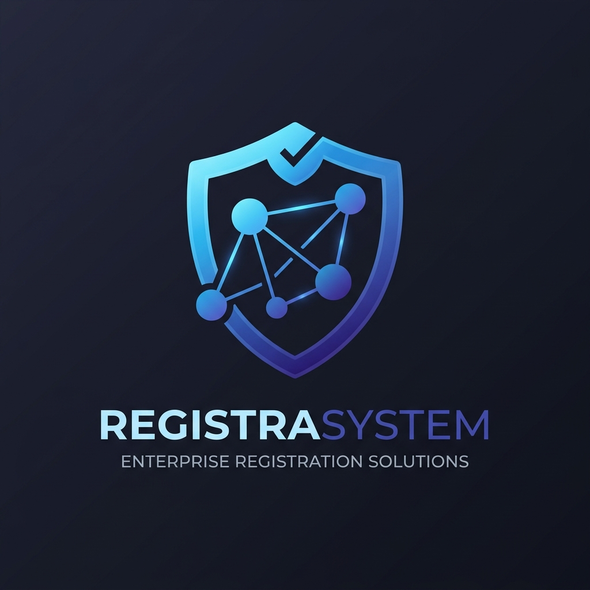
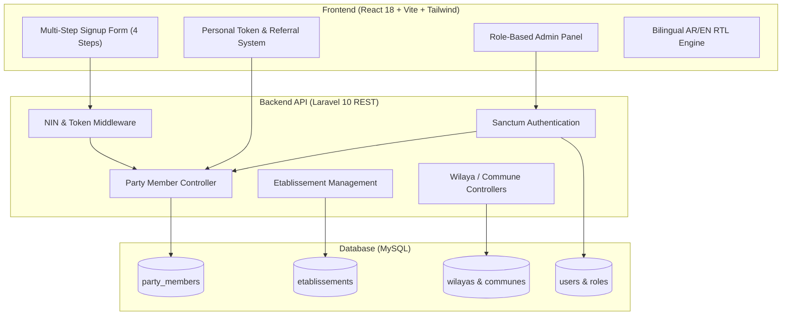
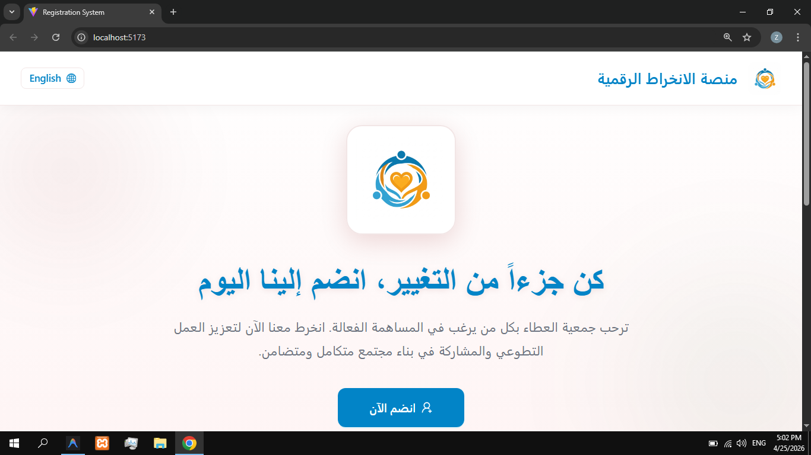
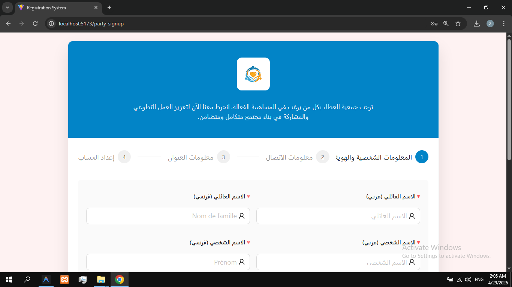
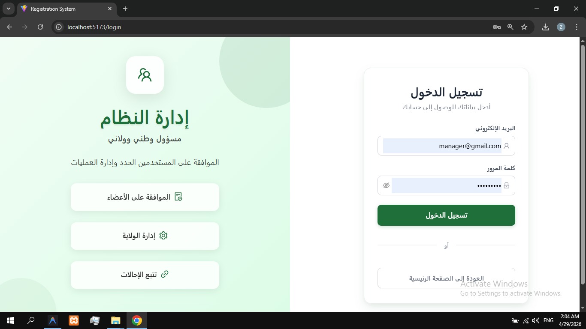
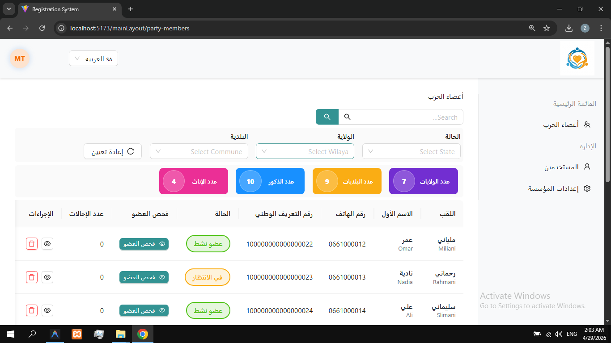

<div align="center">

  

  # On-Demand Registration System
  ### *Custom-Built Scalable Enterprise Membership & Registration Platform*

  [](https://laravel.com)
  [](https://reactjs.org)
  [](https://vitejs.dev)
  [](https://tailwindcss.com)
  [](LICENSE)

</div>

---

## 📌 Table of Contents
- [Executive Overview](#-executive-overview)
- [The Problem](#-the-problem)
- [The Approach](#-the-approach)
- [The Solution](#-the-solution)
- [Key Features & Capabilities](#-key-features--capabilities)
- [System Architecture](#-system-architecture)
- [Application Screenshots](#-application-screenshots)
- [Getting Started & Installation](#-getting-started--installation)
  - [Prerequisites](#prerequisites)
  - [Backend Setup (Laravel)](#backend-setup-laravel)
  - [Frontend Setup (React + Vite)](#frontend-setup-react--vite)
- [Environment Configuration](#-environment-configuration)
- [API Reference Overview](#-api-reference-overview)
- [Impact & Engineering Learnings](#-impact--engineering-learnings)
- [License](#-license)

---

## 📋 Executive Overview

The **On-Demand Registration System** is an enterprise-ready, white-label digital membership and registration platform designed specifically for political parties, non-governmental organizations (NGOs), trade unions, and civic associations. 

Built with **Laravel 10** RESTful APIs and a **React 18 + Vite** single-page frontend, the system streamlines member onboarding, automates National Identification Number (NIN) verification, tracks personal referral links, and provides real-time multi-regional delegation management.

---

## ⚡ The Problem

Organizations operating across multi-regional jurisdictions frequently face major bottlenecks:
- **Paper Sign-ups & Manual Entry**: Traditional paper registration is error-prone, slow to process, and impossible to scale across regions.
- **Custom Development Costs**: Building custom registration portals from scratch for each independent branch or campaign is prohibitively expensive.
- **Identity & Fraud Prevention**: Lack of validation allows duplicate, invalid, or fake member sign-ups.
- **Regional Administrative Overhead**: Local delegates struggle to manage member lists without central coordination.

---

## 🎯 The Approach

We engineered a **modular, multi-tenant capable architecture** where a single core codebase can be rapidly configured for different organizations, campaigns, or regional branches without code refactoring.

- **Modular Branding Engine**: Custom themes, logos, color palettes, and header messaging per establishment.
- **Geographic Data Hierarchy**: Integrated Wilayas and Communes structural mapping for precise regional data partitioning.
- **Layered Validation**: Progressive multi-step onboarding with immediate field verification at each step.

---

##💡 The Solution

A fully configurable, bilingual (Arabic & English with full RTL/LTR support) platform featuring:
1. **Public Multi-Step Registration**: A guided 4-step wizard with National Identification Number (NIN) validation.
2. **Viral Referral System**: Automated token generation giving each member a personalized invitation URL and tracking leaderboard metrics.
3. **Tiered Admin Dashboard**: Role-based access control (RBAC) allowing national and regional administrators to view, approve, export, and audit registration batches.
4. **Dynamic Establishment Parameters**: Instant customization of logo, primary/secondary colors, terms of service, and establishment settings.

---

## 🚀 Key Features & Capabilities

| Feature Category | Description |
| :--- | :--- |
| **Guided 4-Step Registration** | Step-by-step onboarding pipeline designed to maximize completion rates while validating personal data, contact information, geographic location, and identity credentials. |
| **NIN Verification** | Built-in National Identification Number validation preventing duplicate registrations and fake accounts. |
| **Personal Token & Referrals** | Every registered user receives a unique referral link and token, fostering organic growth and referrer leaderboards. |
| **Geographic Hierarchy** | Built-in database structure mapping Wilayas (provinces) and Communes (districts) for regional filtering and delegation. |
| **Role-Based Admin Portal** | Dedicated administrative suite with Sanctum authentication for member status management, bulk operations, and parameters tuning. |
| **Bilingual AR/EN & RTL** | Native Right-To-Left (RTL) support tailored for Arabic-language priority environments alongside English. |
| **White-Label Customization** | Dynamic establishment branding allowing instant updates to logos, headers, colors, and legal notices. |

---

## 🏗️ System Architecture



---

## 📷 Application Screenshots

<div align="center">

### Registration Flow & Member Portal

| Step 1: Identity & Initial Registration | Step 2: Personal Details & Location |
| :---: | :---: |
|  |  |

| Step 2.1: Verification & NIN Validation | Step 3: Referral Token & Confirmation |
| :---: | :---: |
|  |  |

</div>

---

## 🛠️ Getting Started & Installation

### Prerequisites
Make sure you have the following installed on your machine:
- **PHP** >= 8.1
- **Composer** >= 2.x
- **Node.js** >= 18.x and **npm**
- **MySQL Database Server**

---

### Backend Setup (Laravel)

1. **Navigate to the backend directory**:
   ```bash
   cd backend
   ```

2. **Install PHP dependencies via Composer**:
   ```bash
   composer install
   ```

3. **Configure Environment File**:
   ```bash
   cp .env.example .env
   ```
   *Edit `.env` to update your database credentials (`DB_DATABASE`, `DB_USERNAME`, `DB_PASSWORD`).*

4. **Generate Application Key**:
   ```bash
   php artisan key:generate --ansi
   ```

5. **Run Migrations & Seed Initial Data**:
   ```bash
   php artisan migrate --seed
   ```

6. **Create Storage Symbolic Link**:
   ```bash
   php artisan storage:link
   ```

7. **Start the Laravel Development Server**:
   ```bash
   php artisan serve
   ```
   *Backend API will run at `http://127.0.0.1:8000`.*

---

### Frontend Setup (React + Vite)

1. **Navigate to the frontend directory**:
   ```bash
   cd ../frontend
   ```

2. **Install Node.js dependencies**:
   ```bash
   npm install
   ```

3. **Configure Environment File**:
   ```bash
   cp .env.example .env
   ```
   *Ensure `VITE_API_BASE_URL` points to `http://localhost:8000`.*

4. **Start the Vite Development Server**:
   ```bash
   npm run dev
   ```
   *Frontend application will run at `http://localhost:5173`.*

---

## ⚙️ Environment Configuration

### Backend Environment Variables (`backend/.env`)

| Variable | Description | Default Value |
| :--- | :--- | :--- |
| `APP_NAME` | Application title | `"Registration System"` |
| `APP_ENV` | Application environment | `local` |
| `APP_URL` | Base backend URL | `http://localhost:8000` |
| `DB_CONNECTION` | Database driver | `mysql` |
| `DB_DATABASE` | MySQL Database name | `registration_app` |
| `SANCTUM_STATEFUL_DOMAINS` | Frontend stateful origin domains | `localhost:5173,127.0.0.1:5173` |

### Frontend Environment Variables (`frontend/.env`)

| Variable | Description | Default Value |
| :--- | :--- | :--- |
| `VITE_API_BASE_URL` | Backend Laravel API URL | `http://localhost:8000` |

---

## 📡 API Reference Overview

### Public Routes

| Method | Endpoint | Description |
| :--- | :--- | :--- |
| `POST` | `/api/party-members/register` | Public 4-step member sign-up registration. |
| `GET` | `/api/party-members/top-referrers` | Fetch top referrer leaderboard statistics. |
| `GET` | `/api/wilayas/dropdown` | List Wilayas for geographic select inputs. |
| `GET` | `/api/communes/dropdown` | List Communes filtered by selected Wilaya. |
| `POST` | `/api/signup` | Register new administrative user. |
| `POST` | `/api/login/{id}` | Authenticate admin user. |

### Protected Routes (`auth:sanctum`)

| Method | Endpoint | Description |
| :--- | :--- | :--- |
| `GET` | `/api/user` | Fetch currently authenticated user context. |
| `GET` | `/api/party-members` | List party members with pagination and filtering. |
| `PUT` | `/api/party-members/{id}/state` | Update member approval status ('pending', 'approved', 'rejected'). |
| `POST` | `/api/party-members/{id}/regenerate-token` | Regenerate member referral token. |
| `GET` | `/api/etablissements/count` | Retrieve statistics summary count. |
| `POST` | `/api/etablissements/{id}/upload-logo` | Upload custom establishment logo. |

---

## 📈 Impact & Engineering Learnings

### Business & Operational Impact
- **Scale**: Architected to support tens of thousands of simultaneous registrations per campaign.
- **Automation**: Drastically reduces registration processing time from days to automated real-time validation.
- **Delegation**: Enables regional leaders to manage local lists independently without central data bottlenecks.

### Key Engineering Insights
> 💡 **Architectural Modularity**: Designing for configurable multi-tenancy from day one pays off exponentially when onboarding new organizations or branches.

> 💡 **Form UX & Progressive Disclosure**: Splitting long registration forms into a multi-step wizard with real-time per-step field validation drastically decreases drop-off rates and improves data quality.

---

## 📄 License

This project is licensed under the [MIT License](LICENSE).
