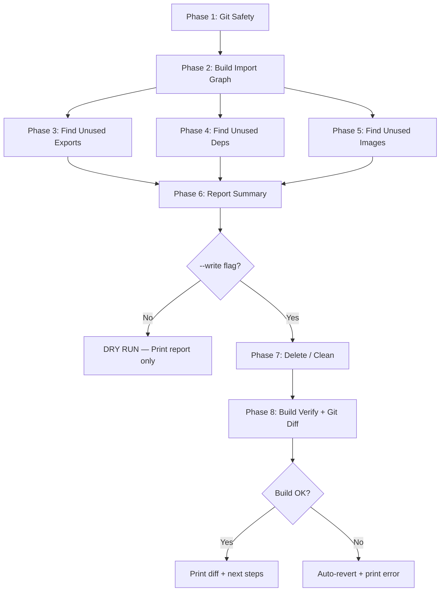

# Dead Code & Unused File Cleanup Script — Plan

## Goal
Create a single script [`find-dead-code.mjs`](file:///c:/freelanceProjects/Registration%20System/frontend/scripts/find-dead-code.mjs) that detects **unused files**, **unused exports**, **unused dependencies**, and **dead code** — then optionally removes them. Follows the same conventions as your existing scripts ([`find-duplicate-keys.mjs`](file:///c:/freelanceProjects/Registration%20System/frontend/scripts/find-duplicate-keys.mjs), [`remove-console-logs.mjs`](file:///c:/freelanceProjects/Registration%20System/frontend/scripts/remove-console-logs.mjs)).

---

## Usage (after implementation)

```bash
# Dry run — report only, no changes
npm run find-dead-code

# Write mode — auto-delete dead files, strip unused exports, uninstall unused deps
npm run delete-dead-code
```

---

## npm scripts to add to [`package.json`](file:///c:/freelanceProjects/Registration%20System/frontend/package.json)

```json
"find-dead-code": "node scripts/find-dead-code.mjs",
"delete-dead-code": "node scripts/find-dead-code.mjs --write"
```

---

## Dependencies to install

```bash
npm install -D ts-morph
```

> `ts-morph` is a TypeScript/JS compiler wrapper that can parse import graphs, resolve module paths, and find unused exports — all without needing TypeScript in the project. It works on `.js` and `.jsx` files too.

---

## Script Phases

### Phase 1 — Git Safety Check
> Reuse the exact same pattern from [`find-duplicate-keys.mjs`](file:///c:/freelanceProjects/Registration%20System/frontend/scripts/find-duplicate-keys.mjs#L54-L131)

| Step | Detail |
|------|--------|
| 1a | Verify `git` is available |
| 1b | Verify we're inside a git repo |
| 1c | Auto-commit uncommitted changes with timestamped message: `"wip: snapshot before dead code cleanup (timestamp)"` |
| 1d | Print current `HEAD` and recovery instructions |

---

### Phase 2 — Build the Import Graph
Crawl from the entry points and build a complete dependency graph of every file in the project.

| Step | Detail |
|------|--------|
| 2a | **Identify entry points**: `src/main.jsx` (Vite entry), plus `vite.config.*` |
| 2b | **Recursive import resolution**: Starting from each entry point, follow every `import`/`require`/`import()` statement, resolving paths (including aliases from `vite.config.js` if any) |
| 2c | **Collect all reachable files**: Build a `Set<string>` of every file path that is transitively imported |
| 2d | **Collect all project files**: Scan `src/` recursively for all `.js`, `.jsx`, `.css`, `.json`, `.svg` files |
| 2e | **Diff**: Files in the project but NOT in the import graph = **unreachable / dead files** |

> [!NOTE]
> Special handling needed for:
> - Dynamic imports `import('./path')` — parse the string argument
> - CSS/image imports — track but don't follow
> - Files in `public/` — these are served statically, never in the import graph (exclude from dead file detection)
> - Files in `scripts/` — exclude (tooling, not app code)

---

### Phase 3 — Find Unused Exports
For every file that IS reachable, check if all of its named exports are actually imported somewhere.

| Step | Detail |
|------|--------|
| 3a | For each reachable file, parse its `export` statements (named exports, default export) |
| 3b | For each exported symbol, search the entire codebase for `import { symbol }` or `import symbol from` that references it |
| 3c | An export with **zero importers** = **unused export** |
| 3d | **Exclude**: Default exports of entry-point files, and exports from files in `contexts/` (React contexts may be consumed via `useContext` patterns) |

> [!IMPORTANT]
> This is where the most impactful cleanup happens — dead functions, unused helper utilities, abandoned component exports.

---

### Phase 4 — Find Unused Dependencies
Compare `dependencies` and `devDependencies` in [`package.json`](file:///c:/freelanceProjects/Registration%20System/frontend/package.json) against actual imports across the codebase.

| Step | Detail |
|------|--------|
| 4a | Read all dependency names from `package.json` |
| 4b | Scan all `.js`/`.jsx` files for `import ... from '<package>'` or `require('<package>')` |
| 4c | Dependencies never imported anywhere = **unused dependencies** |
| 4d | **Whitelist** (don't flag as unused): `@vitejs/plugin-react`, `vite`, `eslint*`, `postcss`, `autoprefixer`, `tailwindcss`, `@tailwindcss/*`, `@types/*`, `globals` — these are config/tooling deps, not directly imported in app code |

> [!WARNING]
> `moment` and `dayjs` both exist in your dependencies — this phase should flag if one of them is unused (likely `moment` since `dayjs` is a lighter replacement).

---

### Phase 5 — Find Unused Images & Assets
Check if image files in `src/assets/img/` are referenced anywhere.

| Step | Detail |
|------|--------|
| 5a | List all files in `src/assets/img/` |
| 5b | For each image, search the codebase for its filename in `import` statements or string references |
| 5c | Images with zero references = **unused assets** |

---

### Phase 6 — Report Summary
Print a structured, color-coded report to the terminal.

```
═══════════════════════════════════════════════════════
  DEAD CODE CLEANUP REPORT
  Mode: DRY RUN (no changes made)
  Scanned: 127 files in src/
═══════════════════════════════════════════════════════

  📁 UNREACHABLE FILES (never imported)              5
  ──────────────────────────────────────────────────
    src/assets/components/OldWidget/OldWidget.jsx
    src/assets/views/TestPage.jsx
    src/assets/utils/deprecated-helpers.js
    ...

  📦 UNUSED EXPORTS (exported but never imported)    12
  ──────────────────────────────────────────────────
    src/assets/utils/helpers.js
      → formatDate()
      → calculateAge()
    src/assets/components/Table/Table.jsx
      → TableFooter
    ...

  📚 UNUSED DEPENDENCIES (in package.json)           2
  ──────────────────────────────────────────────────
    moment         (dependencies)
    ...

  🖼️  UNUSED IMAGES                                   3
  ──────────────────────────────────────────────────
    src/assets/img/old-logo.png
    ...

  TOTALS:
    Dead files:         5
    Unused exports:    12
    Unused deps:        2
    Unused images:      3
═══════════════════════════════════════════════════════
```

---

### Phase 7 — Write Mode (`--write`)
Only runs when `--write` flag is passed.

| Step | Action | Reversibility |
|------|--------|---------------|
| 7a | **Delete unreachable files** | `git checkout -- .` restores them |
| 7b | **Remove unused export statements** from files (keep the function/variable but remove the `export` keyword; or delete the entire function if it's only exported and never used locally) | Same |
| 7c | **Run `npm uninstall <pkg>`** for each unused dependency | `npm install` from git-restored `package.json` |
| 7d | **Delete unused image files** | `git checkout -- .` |

---

### Phase 8 — Post-Write Verification & Git Diff

| Step | Detail |
|------|--------|
| 8a | Run `npm run build` programmatically to verify nothing broke |
| 8b | If build **fails**: auto-revert all changes (`git checkout -- .`), print error, exit |
| 8c | If build **succeeds**: print `git diff` output showing all changes |
| 8d | Print next-steps instructions (commit, test with `npm run dev`, or revert) |

---

## Execution Order Summary



---

## Optional Enhancements (can add later)

| Feature | Description |
|---------|-------------|
| `--interactive` flag | Prompt for each deletion (y/n) instead of bulk delete |
| `--ignore <glob>` flag | Exclude specific files/folders from detection |
| JSON report output | Write results to `reports/dead-code-report.json` for CI integration |
| `--safe` flag | Only delete files, skip export stripping (less risky) |

---

## Risks & Mitigations

| Risk | Mitigation |
|------|------------|
| Dynamic imports (`import()`) not detected | Parse `import()` string arguments; warn about non-literal dynamic imports |
| Context providers consumed implicitly | Whitelist `contexts/` directory by default |
| CSS modules or side-effect imports | Detect `import './file.css'` as a usage (no named binding) |
| Build breaks after deletion | Phase 8 auto-reverts if `npm run build` fails |
| False positives on dependencies | Curated whitelist for tooling/config-only deps |

> [!TIP]
> The Phase 1 git auto-commit ensures you can **always** recover with `git reset HEAD~1 --hard` no matter what happens.
